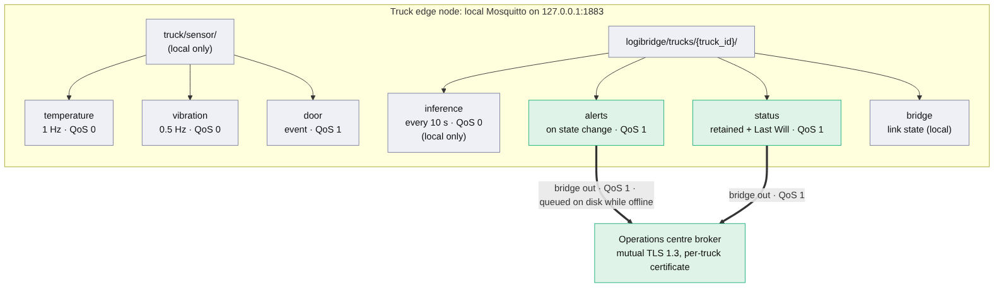
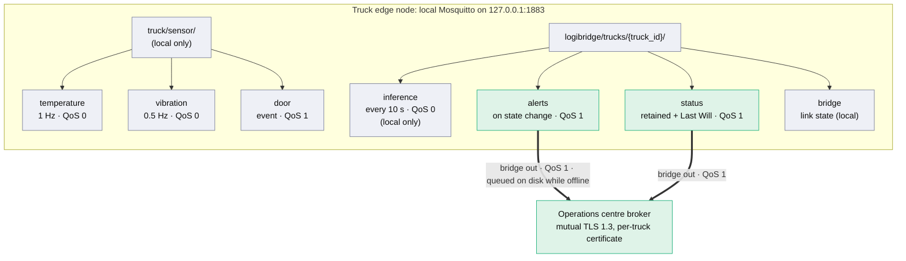

# Task C – MQTT Architecture (LogiEdge edge node)

Every truck runs its own Mosquitto broker on the edge node (`deployment/mosquitto/mosquitto.conf`).
All sensing, inference, alerting and drift monitoring talk to that **local** broker, so the
pipeline keeps working with no cellular coverage. A single, outgoing-only **bridge** forwards
the small set of topics the operations centre needs, and queues them on disk during coverage gaps.

## 1. Topic tree

Source of the figure: `mqtt_topic_tree.mmd` (rendered with Mermaid CLI). GitHub also renders it live:

| Topic | Publisher → subscribers | Rate | Payload | QoS | Retained | Leaves truck? |
|---|---|---|---|---|---|---|
| `truck/sensor/temperature` | `simulator.py` → `inference_service.py`, `preprocessing.py`, `generate_dataset.py` | 1 Hz | `{sensor, timestamp, value °C, setpoint}` | 0 | no | **no** |
| `truck/sensor/vibration` | `simulator.py` → same | 0.5 Hz | `{sensor, timestamp, value g RMS}` | 0 | no | **no** |
| `truck/sensor/door` | `simulator.py` → logging / future features | per event | `{sensor, timestamp, event: OPEN\|CLOSE}` | **1** | no | **no** |
| `logibridge/trucks/{id}/inference` | `inference_service.py` → `drift_monitor.py` (E1) | every 10 s | `{status, model_status, probabilities[3], confidence, temp_mean_c, model, timestamp}` | 0 | no | **no** |
| `logibridge/trucks/{id}/alerts` | `inference_service.py` → ops centre (via bridge) | on state change only | `{seq, event, status, previous_status, model_status, temp_mean_c, confidence, model, timestamp}` | **1** | no | **yes** (bridged, queued) |
| `logibridge/trucks/{id}/status` | `inference_service.py` (+ broker Last Will) → ops centre | on connect / disconnect | `{state: online\|offline, model, timestamp}` | **1** | **yes** | **yes** (bridged) |
| `logibridge/trucks/{id}/bridge` | Mosquitto bridge notifications | on link change | `1` connected / `0` disconnected | 1 | yes | local |

The `logibridge/trucks/{truck_id}/inference` topic is the one the brief requires (Task D2).
Raw sensor topics carry no truck ID because they exist only on that truck's own broker.

## 2. QoS justification per topic

- **temperature, vibration – QoS 0.** These are high-rate streams on a loopback connection, so
  QoS 0 messages are lost only if a process crashes. The pipeline is built to tolerate a missing
  sample: a 5-sample moving average feeds a 30-second window of about 30 temperature and 15
  vibration samples. QoS 1 would add a PUBACK round-trip and broker-side state to about
  130,000 messages per day (86,400 temperature + 43,200 vibration) for no detection benefit.
- **door – QoS 1.** Door events are rare, discrete state changes. One lost `OPEN` or `CLOSE`
  corrupts the open/closed state and the open-duration record, so at-least-once delivery is
  required. A duplicate is harmless because the payload carries its timestamp.
- **inference – QoS 0, local only.** This stream feeds the PSI monitor's 100-inference window. One
  lost window shifts a bin proportion by at most 1 %, far below the 0.25 alert threshold. It is
  deliberately **not bridged**: 8,640 messages per day per truck would undo the bandwidth saving
  (Task A1).
- **alerts – QoS 1, bridged, queued.** Alerts are the product of the system. At-least-once
  delivery, on-disk persistence (`persistence true`) and `local_cleansession false` on the bridge
  mean an alert raised in a 35–90 minute coverage gap is queued and delivered when the link
  returns, even after an edge reboot. `scripts/offline_sync_test.sh` proves this in CI. Duplicates
  can occur under QoS 1, and the per-truck `seq` number lets the backend de-duplicate them.
  QoS 2 would add a four-step handshake on a flaky rural link for a problem `seq` already solves.
- **status – QoS 1, retained, Last Will.** The ops centre sees each truck's current state the moment
  it subscribes (retained). If the inference service dies without disconnecting, the broker
  publishes the `offline` Last Will. A dead monitor must never look like a healthy truck.

## 3. Offline operation and alert synchronisation

1. **Alert generation never needs the network.** Sensors, broker, inference and the alert rule all
   run on the truck. The 90 s SLA is met locally (worst case 50 s of windowing plus under 1 ms of
   inference, `deployment/deployment_recommendation.md` §2).
2. **Chain-of-custody log.** Each alert is appended to `/var/lib/logibridge/alerts.jsonl` and
   fsync'd *before* it is published (`inference/alerting.py`). The log is on a named Docker volume,
   so it survives container replacement during OTA updates (Task E2, task 6).
3. **Store-and-forward.** The bridge queues outgoing alerts and status while the link is down, up to
   `max_queued_messages 10000`. Seven gaps of up to 90 minutes produce a few dozen state-change
   alerts, far below that bound. On reconnect the queue drains in order.
4. **Alerts on state change, not per window.** A two-hour breach is one `ESCALATED` alert followed
   by one `CLEARED` alert, not 720 messages. Uplink volume stays at events, not data.

## 4. Security and privacy (Task A1, privacy)

- The local listener binds to `127.0.0.1` only, so no other device on the truck or the cellular
  network can read raw sensor topics.
- The bridge is outgoing-only (`out`) and limited to `alerts` and `status`. Raw temperature history
  and vibration never leave the truck, which supports the pharmaceutical clients' contractual
  requirement that cargo data is not exposed to third parties.
- The bridge uses mutual TLS 1.3 with a per-truck client certificate (`bridge_certfile`). The
  operations centre can revoke a single truck, and the remote broker can apply per-truck ACLs.

## 5. Data fusion level (Task C3)

LogiEdge uses **feature-level fusion**. Temperature and vibration are filtered and windowed
independently, three features are extracted from each (temperature mean, standard deviation and
rate of change; vibration RMS, peak and kurtosis), and the results are concatenated into one
6-value vector for the model.

- **Against data-level fusion.** The streams run at different rates (1 Hz against 0.5 Hz, 500 Hz
  raw 3-axis on real hardware) and in different units. Fusing raw samples would need
  resampling and alignment, and would feed the model a far larger input than six features. That
  input would no longer fit the 0.53 KB working set M3 achieves.
- **Against decision-level fusion.** Two separate classifiers, one per sensor, combined by voting
  would lose the *joint* signature that separates Critical from Warning: in the dataset both
  classes drift in temperature, and only the vibration features tell them apart. A
  temperature-only model would call both Warning, and a vibration-only model would miss drift.
- **Feature-level fusion** keeps per-sensor preprocessing independent and cheap, gives one small
  model that learns the cross-sensor interaction, and suits a microcontroller-class memory budget.